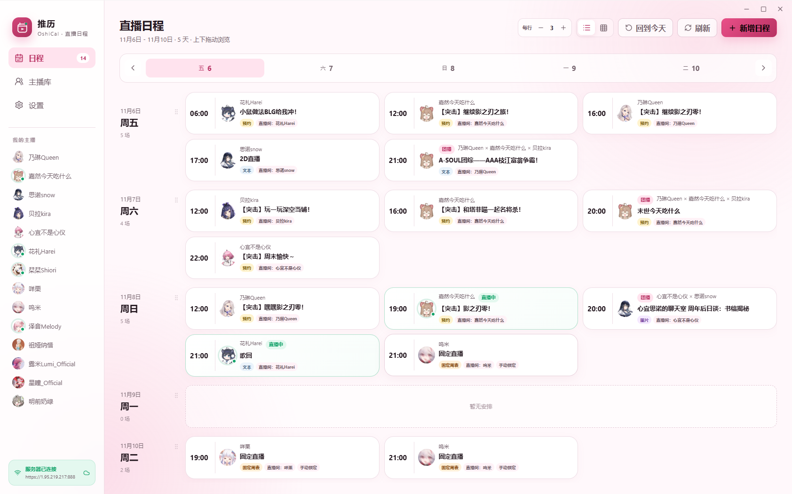
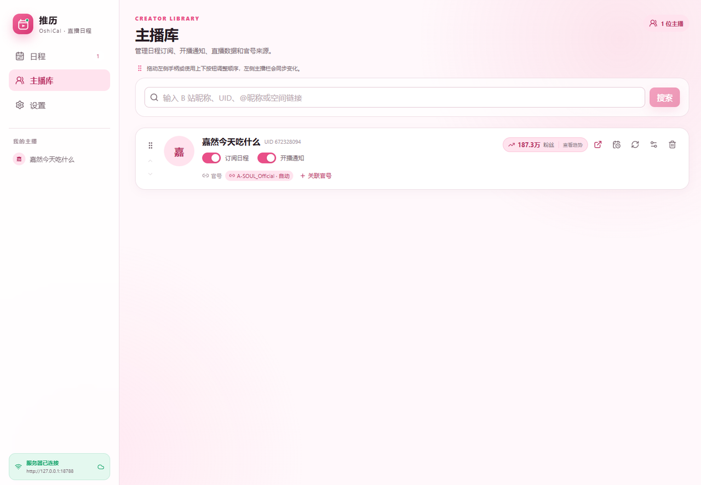
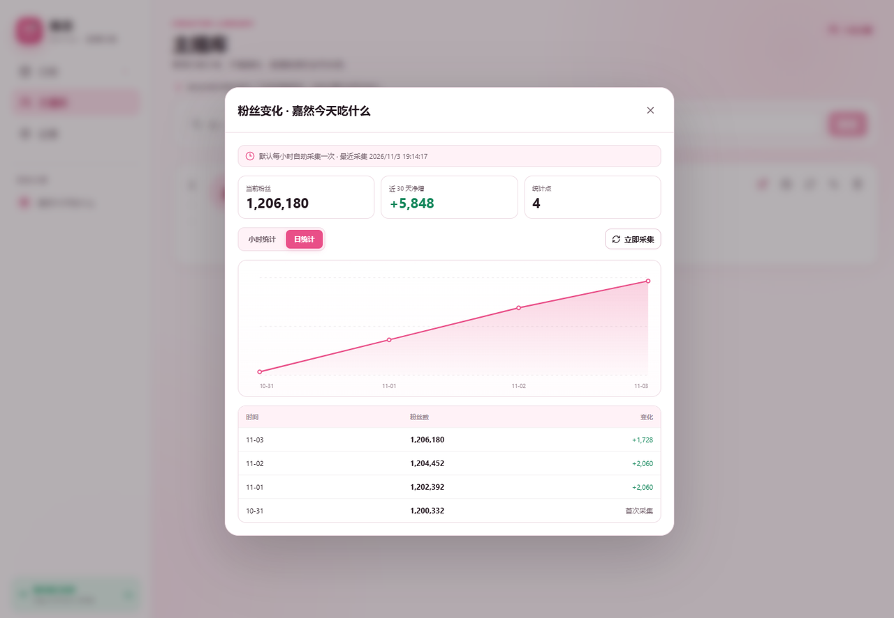
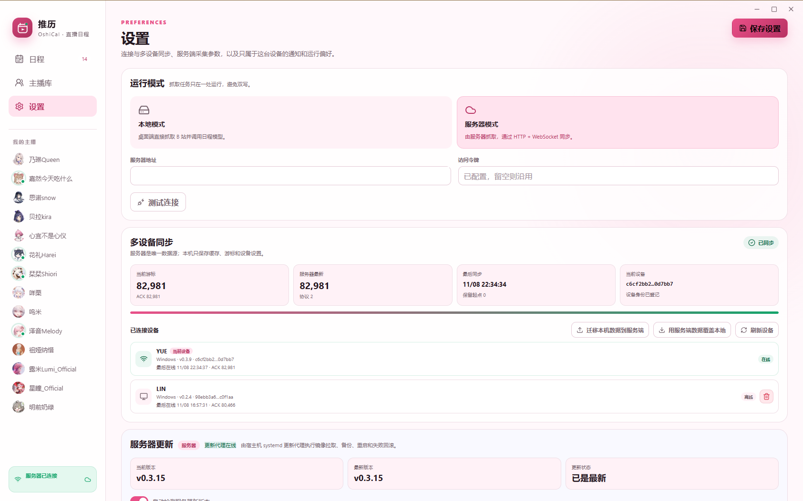

# 推历 OshiCal

> **你是否因为 d 得太多、或者忙上头，回过神来才发现你推的直播已经播完了？**
>
> 有了这款软件，能改变你的情况。

B 站虚拟主播的直播日程与开播提醒工具。桌面端直接抓取 B 站动态、调用视觉模型解析日程，也可以部署一台服务端，让多台设备的日程与开播状态保持一致。

  

## 状态

| 端 | 状态 |
| --- | --- |
| Windows 桌面端 | 可用。安装包、便携版、通知、托盘、自启、应用内更新均已交付 |
| 服务端（Docker / 二进制） | 可用。HTTP API、WebSocket、Web UI、多设备同步、更新代理 |
| Android | 未合入 main。实现在 `feat/android-client` 分支，预发布且功能未完成：无真机验证、无后台保活与推送、无应用内更新 |

## 功能

- **日程抓取**：订阅主播后抓取其动态，纯文本、直播预约卡片、日程图片走同一条解析链路，写入结构化日程。正常文本与预约卡片都交给日程模型（卡片标题/描述与正文一起送模型），同一条动态只调用一次模型；模型不可用时回退到卡片里的结构化时间。
- **日程表**：自选中日期起连续 7 天，时间线 / 日历两种视图；桌面右键、移动端长按编辑或删除；支持手动新增。
- **开播提醒**：Windows Toast 通知 + 托盘常驻 + 可选开机自启，点击通知跳转直播间。
- **直播状态**：启动后静默刷新并在刷新完成时同步界面，直播间入口复用同一套地址解析规则。
- **直播数据**：按主播订阅，统计时长、营收估算、付费人数、最高同时在线、互动人数与弹幕数；原始弹幕与礼物事件只在内存聚合，不落库。
- **粉丝数据**：每小时采样一次快照，支持小时 / 日两种口径的净增、走势与明细，可手动立即采集。
- **LAPLACE 周期数据**（可选）：设置页开关默认关闭，确认免责声明后每 6 小时抓取一次公开列表，主播库显示 `月隐 · 第 N 天` 徽标。
- **多设备同步**：服务端为唯一数据源，客户端保存本地缓存与游标；支持本机数据推送与服务器数据覆盖。
- **两种运行模式**：本地模式（桌面端自行抓取，本机 SQLite）与服务器模式（HTTP + WebSocket）。

体积（0.3.6 构建实测，新版本同量级）：Windows 安装包 7.8 MB，便携版 29.5 MB，服务端单文件 19 MB，Docker 镜像约 37 MB。

## 截图

日程表（时间线视图），卡片标注来源类型与归属直播间：



主播库，订阅与开播通知是两个独立开关：



粉丝趋势，小时 / 日两个口径：



设置页，运行模式与多设备同步状态：



## 技术栈与结构

Rust 1.99 / Tauri 2 / Axum 0.8 / SQLite（SQLx）/ React 19 + TypeScript + Vite。桌面端使用系统 WebView2，不内嵌浏览器内核。

```text
crates/core/          解析、存储与业务规则，不依赖 Tauri / Axum
server/               Axum 服务端：REST、WebSocket、抓取任务、更新管理
src/                  React 前端，桌面端与 Web UI 共用
src-tauri/            Tauri 桌面壳：托盘、通知、凭据、本地抓取
scripts/              版本管理、前端单测与部署脚本
deploy/systemd/       服务端更新代理的 unit / timer
docs/                 设计与发布文档
.github/workflows/    CI、桌面端发布、服务端镜像与二进制、Android 构建
```

## Windows 客户端

从 [Releases](https://github.com/yueTc/OshiCal/releases) 下载最新的 `desktop-v*`：

- `OshiCal_0.3.9_x64-setup.exe`：NSIS 安装包。
- `OshiCal.exe`：便携版，单文件运行，无需 Node.js；首次启动在应用数据目录创建 SQLite 数据库。

首次启动需要配置 OpenAI 兼容的模型接口，未配置时文字与图片解析不会运行。B 站动态接口存在风控，必要时在设置中填写可选的 SESSDATA。

应用内更新位于「设置 → 软件更新」，使用 Tauri Updater 校验签名；GitHub 访问受限时可在同一卡片填写镜像地址（例如 `https://gh-proxy.com/`）。

安装包未做 Authenticode 代码签名，首次运行可能触发 SmartScreen 提示。

## Android（未合入 main）

安卓端的实现只存在于 `feat/android-client` 分支，尚未合并进 main。状态是预发布、功能未完成：没有真机安装、通知点击与扫码登录的验证记录，没有后台保活、FCM 推送与应用内更新，通知仅在应用存活期间产生。

该分支由 `.github/workflows/android.yml` 产出 APK（四个 ABI 合并打包，约 110 MB，文件名版本随分支上的 `tauri.conf.json`），侧载安装，首次启动强制服务器模式，只读服务端数据。

## 服务端部署

服务端负责抓取、解析与推送，客户端只读。两种部署方式任选其一。

### Docker

```powershell
git clone https://github.com/yueTc/OshiCal.git
cd OshiCal
Copy-Item .env.example .env
docker compose pull
docker compose up -d --no-deps oshical
Invoke-RestMethod http://127.0.0.1:8787/api/health
```

镜像：`ghcr.io/yuetc/oshical-server:<版本>` / `:latest`。Web 界面在 `http://<host>:8787`，使用 Bearer Token 登录，数据持久化在 `./data`。

### 二进制压缩包

`server-v*` Release 提供 `oshical-server-<版本>-linux-x86_64.tar.gz` 与 `-windows-x86_64.zip`，内含可执行文件、`dist/`、`.env.example`、部署说明与 `.sha256`。

```bash
tar -xzf oshical-server-0.3.16-linux-x86_64.tar.gz -C /opt/oshical
cd /opt/oshical
cp .env.example .env && vi .env
./oshical-server
```

systemd 单元示例：

```ini
[Unit]
Description=OshiCal Server
After=network-online.target

[Service]
WorkingDirectory=/opt/oshical
EnvironmentFile=/opt/oshical/.env
ExecStart=/opt/oshical/oshical-server
Restart=always

[Install]
WantedBy=multi-user.target
```

### 配置

| 变量 | 默认值 | 说明 |
| --- | --- | --- |
| `OSHICAL_BIND` | `127.0.0.1:8787` | 监听地址；非回环绑定时必须配置 Token |
| `OSHICAL_API_TOKEN` | 空 | 访问令牌，客户端与 Web UI 使用 |
| `OSHICAL_DB_PATH` | `./data/oshical.db` | SQLite 路径 |
| `OSHICAL_WEB_DIR` | `./dist` | 静态界面目录 |
| `OSHICAL_LLM_BASE_URL` | `https://api.openai.com/v1` | OpenAI 兼容接口地址 |
| `OSHICAL_LLM_MODEL` | 空 | 文字 / 视觉模型名 |
| `OSHICAL_LLM_API_KEY` | 空 | 模型密钥 |
| `OSHICAL_SECRETS_KEY` | 空 | 落库模型密钥的加密主密钥，设置后不可更改 |
| `OSHICAL_BILI_COOKIE` | 空 | 可选 SESSDATA，应对动态接口风控 |
| `OSHICAL_LIVE_POLL_SECONDS` | `20` | 直播状态轮询间隔 |
| `OSHICAL_DYNAMIC_POLL_SECONDS` | `300` | 动态轮询间隔 |
| `OSHICAL_PROXY_PORT` | 空 | 出站 HTTP 代理端口 |
| `OSHICAL_UPDATE_DIR` | `./data/system` | 与宿主机更新代理共享的目录 |
| `OSHICAL_FERTILITY_URL` | 空 | 覆盖 LAPLACE 数据抓取地址（自建中转时使用） |

`compose.yaml` 另读 `OSHICAL_IMAGE` 与 `OSHICAL_PORT`。

### 服务端更新

```bash
./scripts/update-server.sh
```

脚本比较镜像 ID，仅在变化时停服、备份 `data/`、切换镜像并检查 `/api/health`，失败回滚上一镜像。可挂 cron 定时执行。

客户端侧的一键更新需要宿主机安装 systemd 更新代理（应用容器不挂 Docker Socket）：

```bash
sudo bash scripts/install-oshical-updater.sh
sudo bash scripts/install-oshical-updater.sh --check
```

细节见 [docs/06-deployment.md](docs/06-deployment.md)。

## 开发与构建

```powershell
npm install
npm run dev:desktop          # 桌面端开发
npm run test:web             # 前端单测
cargo test --workspace       # Rust 测试
```

服务端本地运行：

```powershell
$env:OSHICAL_API_TOKEN = "dev-token"
$env:OSHICAL_WEB_DIR = "./dist"
npm run build:web
cargo run -p oshical-server
```

构建产物：

```powershell
npm run build:web
cargo build --release -p oshical-server
cargo build --release -p oshical-desktop
npx tauri build --bundles nsis
```

本仓库仅用于源码修改与文档维护，构建、测试与产物验证交由 GitHub Actions 或外部构建机执行，不在本机生成 `target` 缓存。

## 发布

桌面端与服务端使用独立版本号与独立标签：

```powershell
node scripts/set-version.mjs desktop 0.3.10
git tag desktop-v0.3.10

node scripts/set-version.mjs server 0.3.16
git tag server-v0.3.16
```

- `desktop-v*`：构建 NSIS 安装包、更新签名与 `latest.json`。
- `server-v*`：构建 GHCR 镜像与 Linux / Windows 二进制，并更新 `server-latest` 清单（prerelease，不覆盖桌面端的 latest）。
- 仓库需配置 `TAURI_SIGNING_PRIVATE_KEY`、`TAURI_SIGNING_PRIVATE_KEY_PASSWORD`；服务端更新代理另用 `OSHICAL_SERVER_UPDATE_HMAC_KEY` 签发清单。

更新地址：

```text
https://github.com/yueTc/OshiCal/releases/latest/download/latest.json
https://github.com/yueTc/OshiCal/releases/download/server-latest/latest-server.json
```

设计与回滚流程见 [docs/11-github-release-and-updater-plan.md](docs/11-github-release-and-updater-plan.md)。

## 安全

- 桌面端模型密钥与 B 站 Cookie 保存在 Windows 凭据管理器；移动端保存在应用私有目录（0600）。
- B 站登录窗口仅允许 B 站域名；Cookie 不回传前端，扫码回调经字段白名单与长度校验。
- 服务端仅从环境变量读取密钥，密钥与 Cookie 不返回前端；非回环绑定强制要求 API Token。
- 图片下载仅允许 `hdslb.com`；直播间跳转仅允许 `https://live.bilibili.com/`。
- 模型输出经长度、时间、URL、主播归属与置信度校验后才入库。

部署时请使用自有域名、独立 Token 与 HTTPS 证书，不要提交真实 `.env`、Token、服务器路径或内部测试数据。

## 已知限制

- 全部产物的二进制未做代码签名，分发时可能触发 SmartScreen 或安全软件提示。
- NSIS 安装包由 CI 构建，未在本机执行安装 / 卸载验证；MSI 未配置。
- Docker 部署、HTTPS / WSS 与数据持久化已在隔离 Linux 环境验收，生产环境仍需绑定正式域名并配置证书续期。
- B 站扫码与内嵌登录窗口可正常打开，但没有可用的账号凭据，尚未完成真实登录后的 Cookie 自动保存验证。
- Windows Toast 进入操作中心后可能不再上报点击事件。
- 图片解析依赖用户自行配置的视觉模型，无有效密钥时不运行。
- 模型自检使用仓库内置的固定日历图，实际准确率取决于所选模型与账号额度。
- Android 端仍在预发布阶段，见上文。
- 服务端为单用户模式，不提供多用户注册。
- 营收 / 付费人数基于公开礼物、SC 与舰长事件估算，不含平台分成、活动折扣与盲盒规则；「最高同时在线」取自公开高能用户数事件的峰值，与主播后台口径可能存在差异。

## 文档

- [docs/00-project-brief.md](docs/00-project-brief.md)
- [docs/01-product-spec.md](docs/01-product-spec.md)
- [docs/02-architecture.md](docs/02-architecture.md)
- [docs/03-ui-spec.md](docs/03-ui-spec.md)
- [docs/04-plan.md](docs/04-plan.md)
- [docs/05-acceptance.md](docs/05-acceptance.md)
- [docs/06-deployment.md](docs/06-deployment.md)
- [docs/07-known-issues.md](docs/07-known-issues.md)
- [docs/08-client-server-migration-plan.md](docs/08-client-server-migration-plan.md)
- [docs/09-server-authoritative-multi-device-sync.md](docs/09-server-authoritative-multi-device-sync.md)
- [docs/10-multi-device-sync-implementation-plan.md](docs/10-multi-device-sync-implementation-plan.md)
- [docs/11-github-release-and-updater-plan.md](docs/11-github-release-and-updater-plan.md)
- [docs/12-release-0.3.0.md](docs/12-release-0.3.0.md)
- [docs/13-release-server-0.3.1.md](docs/13-release-server-0.3.1.md)
- [docs/14-release-0.3.2.md](docs/14-release-0.3.2.md)
- [docs/15-release-server-0.3.3.md](docs/15-release-server-0.3.3.md)
- [docs/16-release-0.3.4-server-0.3.6.md](docs/16-release-0.3.4-server-0.3.6.md)
- [docs/17-release-0.3.5-server-0.3.7.md](docs/17-release-0.3.5-server-0.3.7.md)
- [docs/18-release-server-0.3.8.md](docs/18-release-server-0.3.8.md)
- [docs/19-release-server-0.3.9.md](docs/19-release-server-0.3.9.md)
- [docs/20-release-server-0.3.10.md](docs/20-release-server-0.3.10.md)
- [docs/21-release-desktop-0.3.6.md](docs/21-release-desktop-0.3.6.md)
- [docs/21-release-server-0.3.11.md](docs/21-release-server-0.3.11.md)
- [docs/22-release-server-0.3.12.md](docs/22-release-server-0.3.12.md)
- [docs/23-hotfix-updater-semver.md](docs/23-hotfix-updater-semver.md)
- [docs/24-release-server-0.3.13.md](docs/24-release-server-0.3.13.md)
- [docs/25-release-desktop-0.3.7.md](docs/25-release-desktop-0.3.7.md)
- [docs/26-release-server-0.3.14.md](docs/26-release-server-0.3.14.md)
- [docs/27-release-desktop-0.3.8.md](docs/27-release-desktop-0.3.8.md)
- [docs/28-release-server-0.3.15.md](docs/28-release-server-0.3.15.md)
- [docs/30-release-server-0.3.16.md](docs/30-release-server-0.3.16.md)
- [docs/29-release-desktop-0.3.9.md](docs/29-release-desktop-0.3.9.md)

## 参与贡献

欢迎提交 Issue 与 Pull Request。

- **Bug 反馈 / 功能建议**：提到 [GitHub Issues](https://github.com/yueTc/OshiCal/issues)，写清版本号、系统环境与复现步骤；截图或日志能省掉来回追问。
- **提交 PR**：从 `main` 拉分支，改完把 PR 提到 `main`。一个 PR 只做一件事，说明改动动机、实现思路与验证方式；涉及前端或 Rust 侧的改动需能通过 CI 里的单测与构建。
- **安全问题**：报告前先核对上文「安全」与「已知限制」两节、以及 [docs/07-known-issues.md](docs/07-known-issues.md) 里核对已经列出的结论与尚未验证的部分，避免重复。
- **交流**：欢迎到 [LinuxDO 社区](https://linux.do/) 交流 AI 工具与提示词的使用心得。

## 赞助

这个项目是抽空闲时间做的，服务器、模型调用、B 站接口的坑都得自己填。要是它让你少错过几场直播，可以请作者喝杯咖啡。

<div align="center">
  
  <br><sub>微信赞赏码</sub>
</div>

| 渠道 | 说明 |
| --- | --- |
| 微信赞赏码 | 扫码即可，金额随意，可以在留言里写想说的话 |
| GitHub Sponsors | [github.com/sponsors/yueTc](https://github.com/sponsors/yueTc)，可按月赞助 |

<!-- 赞赏码：直接覆盖 docs/sponsor/wechat.png 即可，这段不用改 -->

赞赏码是静态图，不接自动发货或付费解锁。赞助不换取功能优先级，issue 和 PR 该排队还是排队。

## 许可证

Apache License 2.0，全文见 [LICENSE](LICENSE)，第三方归属见 [NOTICE](NOTICE)。再分发时须保留版权、许可与 `NOTICE` 声明，修改文件需显著标注；含专利授权（第 3 条）与商标限制（第 6 条），不得以 `OshiCal` / `推历` 名义为衍生品背书。提交贡献即视为按 Apache-2.0 授权。
